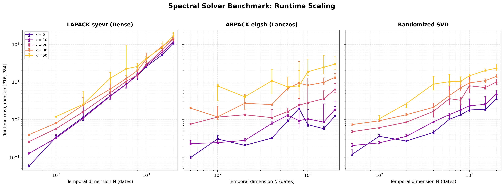
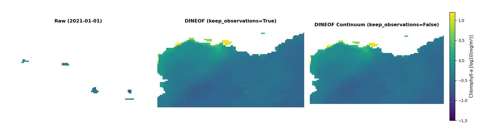

# DINEOF-HPC

 

DINEOF-HPC is a high-performance Python implementation of the Data Interpolating Empirical Orthogonal Functions (DINEOF) algorithm, optimized for massive geophysical and satellite datasets on High-Performance Computing (HPC) architectures.

The project originated as a fork of [`pyDINEOF`](https://github.com/acoque/pyDINEOF) (Arthur Coqué, RBINS, 2025), a 100% Python translation of canonical [DINEOF](https://github.com/aida-alvera/DINEOF) (GHER). It has since been re-engineered into an autonomous, scalable engine capable of handling high-resolution satellite rasters without out-of-memory crashes.

Applying canonical DINEOF to high-resolution missions (Sentinel-2, Landsat,...) runs into two ceilings: **memory allocation** (dense spatial mode matrices $U \in \mathbb{R}^{M \times k}$ trigger OOM failures above $10^{7}$ pixels) and **variance attenuation** (truncated EOF iterations act as a regression-to-the-mean filter, underestimating episodic extremes in high-dynamic-range tracers such as SPM, POC, or Chlorophyll-a). DINEOF-HPC addresses both through in-place chunked updates, an uncertainty-modulated Quantile Mapping scheme, streaming Optimal Interpolation error, spatial-patch cross-validation, and local residual objective analysis - all detailed in the [Core Formulations](#core-formulations) section below.

---

## Table of Contents
- [Feature Matrix](#feature-matrix-upstream-pydineof-vs-canonical-fortran)
- [Performance Benchmarks](#performance-benchmarks-vs-canonical-fortran)
- [Core Formulations](#core-formulations)
  - [1. Unconditionally Stable 1D Implicit Temporal Diffusion](#1-unconditionally-stable-1d-implicit-temporal-diffusion)
  - [2. Spatial Patch Hold-out & Pooled RMSE](#2-spatial-patch-hold-out--pooled-rmse)
  - [3. In-Stream Optimal Interpolation (OI) Analysis Error](#3-in-stream-optimal-interpolation-oi-analysis-error)
  - [4. Exact Analytical Physical Error for Log-Normal Distributions](#4-exact-analytical-physical-error-for-log-normal-distributions)
  - [5. Tracer-Agnostic Quantile Mapping with KGE Arbitration Gate](#5-tracer-agnostic-quantile-mapping-with-kge-arbitration-gate)
  - [6. Local Residual Objective Analysis (Barnes Refinement)](#6-local-residual-objective-analysis-barnes-refinement)
- [Implementation Details](#implementation-details)
- [Software Architecture & Dataflow](#software-architecture--dataflow)
  - [Directory Structure](#directory-structure)
  - [Computational Dataflow](#computational-dataflow)
- [Installation](#installation)
- [Usage Examples](#usage-examples)
  - [1. Minimal In-Memory Example (NumPy Array)](#1-minimal-in-memory-example-numpy-array)
  - [2. HPC Batch Execution (NetCDF Pipeline)](#2-hpc-batch-execution-netcdf-pipeline)
- [Input Parameters Reference](#input-parameters-reference)
  - [1. Core Engine: `dineof(...)`](#1-core-engine-dineof)
  - [2. High-Level Pipeline: `run_reconstruction_pipeline(...)`](#2-high-level-pipeline-run_reconstruction_pipeline)
- [Output Deliverables & Diagnostics](#output-deliverables--diagnostics)
- [Methodological References](#methodological-references)
- [License](#license)

---

## Feature Matrix: Upstream `pyDINEOF` vs. Canonical Fortran

| Component | Fortran DINEOF (GHER Reference) | Upstream `pyDINEOF` | DINEOF-HPC (This Implementation) |
| :--- | :--- | :--- | :--- |
| **Spectral Solver** | Iterative restarted Lanczos via ARPACK (`dsaupd`/`dseupd`). | Iterative restarted Lanczos via `scipy.sparse.linalg.eigsh`. | Dense Hermitian eigensolver (`scipy.linalg.eigh`) with dynamic crossover to Lanczos / Randomized SVD - see [Performance Benchmarks](#performance-benchmarks-vs-canonical-fortran). |
| **Memory & Iterative Update** | BLAS matrix-vector operations on 1D ocean coordinate vectors. | Explicit spatial mode computation $U = A V \Sigma^{-1}$, followed by dense $U \Sigma V^{T}$ allocation. | Sequential in-place spatial chunking with multi-threaded Numba JIT kernels - see [Implementation Details](#implementation-details). |
| **Covariance Construction** | Direct matrix products. | Full matrix multiplication $A^{T} A$ (`np.dot`). | Matrix product $A^{T} A$ (`np.matmul`) with precomputed, frozen spatial subsampling indices. |
| **Missing Data Indexing** | 1D index arrays of ocean points and gaps. | Global coordinate tuples via `np.isnan(X).nonzero()`. | Boolean masking combined with chunked BLAS projections (1 byte per spatiotemporal element). |
| **Temporal Diffusion Filter** | Discrete Laplacian diffusion with uniform step increments (`dindiff.f`). | Discrete diffusion with time delta in seconds cast to `uint16`. | Unconditionally stable 1D implicit diffusion (Thomas algorithm) - see [§1](#1-unconditionally-stable-1d-implicit-temporal-diffusion). |
| **Cross-Validation Sampling** | Cloud mask files or uniform random points. | Stochastic sampling of isolated pixels (`numpy.random.choice`). | Spatial patch hold-out ($L \times L$ blocks) - see [§2](#2-spatial-patch-hold-out--pooled-rmse). |
| **CV Sample Sizing** | User-defined parameter. | Continuous formula: $\min(0.01 M N + 40, 0.03 M N)$. | Adaptive sizing with an upper ceiling (`cv_max_points`, default $5 \times 10^{5}$), preventing extraction bottlenecks on rasters with $M N \gt 10^{9}$. |
| **Post-Validation Convergence** | Restores CV points and iterates until `toliter`. | Restores CV points and iterates until `toliter`. | Protocol maintained; out-of-sample predictions frozen at $k_{\text{opt}}$ before the final pass, preventing leakage. Optimal state cached on disk via `memmap`. |
| **Uncertainty Estimation (OI)** | Companion routine (`dineof_error.f90`). | Not implemented. | Analytical reduced-subspace OI analysis error - see [§3](#3-in-stream-optimal-interpolation-oi-analysis-error). |
| **Log-Normal Error Derivation** | Not implemented. | Not implemented. | Exact analytical formulation - see [§4](#4-exact-analytical-physical-error-for-log-normal-distributions). |
| **Distribution Mapping (Q-Map)** | Not implemented. | Not implemented. | In-stream Quantile Mapping with KGE arbitration gate - see [§5](#5-tracer-agnostic-quantile-mapping-with-kge-arbitration-gate). |
| **Local Spatial Autocorrelation**| Not implemented (purely global EOF modes). | Not implemented (purely global EOF modes). | Normalized 2D Barnes objective analysis of spatial observation residuals with CV support gating - see [§6](#6-local-residual-objective-analysis-barnes-refinement). |
| **Observation Preservation** | Binary substitution (`keep_obs=True` only). | Binary substitution (`keep_obs=True` only). | Dual-mode: strict gap-filling or seamless filtered EOF continuum - see [Implementation Details](#implementation-details). |

---

## Performance Benchmarks vs. Canonical Fortran

Canonical Fortran DINEOF (GHER reference) remains standard for coarse-to-moderate oceanographic grids, but hits two ceilings on modern high-resolution remote sensing series: standard `INTEGER*4` indexing caps arrays at $2^{31} - 1 \approx 2.14 \times 10^{9}$ elements, and dense allocation of spatial mode matrices does not scale past $10^{7}$ pixels. DINEOF-HPC uses 64-bit addressing with chunked in-place updates ($m \ll M$), bounding peak RAM to $\mathcal{O}(m \cdot N + m \cdot k)$ regardless of grid size.

Benchmark on a dual-socket HPC node (dual AMD EPYC 48-core processors, 96 threads, 512 GB RAM) on a regional grid ($\sim 6 \times 10^{7}$ active water pixels, 200+ dates):

| Processing Phase | Canonical Fortran DINEOF (GHER) | DINEOF-HPC | Architectural Factor |
| :--- | :--- | :--- | :--- |
| **Max Indexable Elements** | Bounded to $\lt 2.14 \times 10^{9}$ (`INTEGER*4`) | **Unbounded** (64-bit + chunking) | Native processing of $10^{7}$ to $10^{8}$ marine pixels |
| **Covariance Step ($A^{T} A$)** | Dense full-grid product (~35.0 s/iter) | Precomputed subsampling (~5.3 s/iter) | **~6.6x faster**, $10^{-5}$ spectral equivalence |
| **Missing Value Update** | OpenMP loops over 1D arrays (~3.8 s/iter) | Numba JIT parallel kernel (~3.35 s/iter) | Cache-aligned L3 streaming, zero 2D scatter penalties |
| **Leading Mode Iteration** | ~39.5 s/iteration | **~11.2 s/iteration** | **~3.5x speedup** |
| **OI Error Estimation** | Detached binary, full disk re-read (~45-60 min) | In-stream during NetCDF export (~15 min) | Eliminates 50+ GB redundant I/O passes |
| **Full Pipeline (~15 modes)** | **~5h 25min** (projected) | **~1h 35min** (measured) | **~3.5x end-to-end acceleration** |


Figure: Runtime scaling across temporal dimension $N$ and truncation rank $k$, showing the empirical crossover boundary $N_{\text{crit}}(k)$ where Lanczos outperforms dense LAPACK.

**Spectral solver selection (`solver='auto'`).** Temporal EOF modes come from diagonalizing $B = A^{T} A \in \mathbb{R}^{N \times N}$. LAPACK dense (`syevr`) performs a complete tridiagonal reduction in $\mathcal{O}(N^{3})$, invariant to $k$; ARPACK Lanczos (`eigsh`) and Randomized SVD instead solve reduced Krylov projections in $\mathcal{O}(k \cdot N^{2})$, with convergence governed by the relative eigengap under the Kaniel-Paige-Saad theorem. `'auto'` applies the empirical crossover:

$$N^*(k) \approx \max(70, 10k)$$

Dense LAPACK below this threshold (avoiding Krylov restart overhead), Lanczos/Randomized SVD above it (substantial gains for $N \gt 500$).

**Key drivers of the speedup:**
1. **Precomputed covariance subsampling** - spatial subsampling indices are frozen once at startup rather than redrawn every iteration, cutting covariance FLOPs and memory traffic by up to an order of magnitude without compromising leading-EOF accuracy.
2. **Stationary background precomputation for OI** - the background covariance diagonal is computed once outside the temporal loop, avoiding redundant spatial-mode projections across tens of millions of pixels.
3. **Multi-socket NUMA interleaving** - running with `numactl --interleave=all` distributes data pages across all memory channels, avoiding Infinity Fabric bus saturation during BLAS operations on dual-socket nodes.

---

## Core Formulations

The six formulations below are DINEOF-HPC's genuine methodological additions beyond canonical DINEOF and `pyDINEOF`. Implementation-only changes (chunked projection, progressive initialization, observation-preservation modes, automatic rank search) are covered more briefly in [Implementation Details](#implementation-details).

### 1. Unconditionally Stable 1D Implicit Temporal Diffusion
To filter temporal covariance matrices over irregular observation dates without CFL time-step clamping, an implicit backward Euler formulation is solved via the Thomas algorithm:

$$(I - \alpha L) B^{n+1} = B^{n}$$

Using variable intervals $\Delta t_{i} = t_{i+1} - t_{i}$, cell widths use half-cell boundaries ($\Delta t_{e,0} = 0.5 \Delta t_{0}$, $\Delta t_{e,N-1} = 0.5 \Delta t_{N-2}$, $\Delta t_{e,i} = 0.5(\Delta t_{i-1} + \Delta t_{i})$ elsewhere). Symmetrization $\tilde{B}_{\text{sym}} = 0.5(\tilde{B} + \tilde{B}^{T})$ guarantees self-adjointness.

### 2. Spatial Patch Hold-out & Pooled RMSE
Isolated-pixel cross-validation underestimates reconstruction error due to spatial autocorrelation. Validation points are extracted as 2D patches ($L \times L$ pixels) simulating realistic cloud cover. Optimal rank $k_{\text{opt}}$ minimizes the pooled RMSE:

$$\text{RMSE}_{\text{CV}}(k) = \sqrt{\frac{1}{N_{\text{eval}}} \sum_{f=1}^K \sum_{i \in \text{patch}_f} \left(X_a(i) - X_o(i)\right)^2}$$

Out-of-sample predictions are frozen at $k_{\text{opt}}$ prior to the final convergence pass with restored observations, preventing validation data leakage.

### 3. In-Stream Optimal Interpolation (OI) Analysis Error
Following Beckers et al. (2006), analysis error variance is calculated in the reduced EOF subspace ($k \times k$) rather than in spatial coordinates ($M \times M$):

$$A_t = \Lambda_k^{-1} + \frac{1}{\sigma_o^2} U_{\text{obs},t}^T U_{\text{obs},t}$$

where:

$$\Lambda_k = \frac{1}{N}\mathrm{diag}(s_1^2, \dots, s_k^2), \qquad \sigma_o = \text{RMSE}_{\text{CV}}(k_{\text{opt}})$$

The stationary background variance diagonal is precomputed once:

$$[B]_{mm} = \sum_{i=1}^k \lambda_i (U_k)_{mi}^2$$

During NetCDF export, local error variance and relative error ratio are evaluated on the fly:

$$[P_t]_{mm} = \sum_{i=1}^k \sum_{j=1}^k (U_k)_{mi} [A_t^{-1}]_{ij} (U_k)_{mj}, \qquad r_t(m) = \frac{[P_t]_{mm}}{[B]_{mm}} \in [0, 1]$$

### 4. Exact Analytical Physical Error for Log-Normal Distributions
For log-transformed environmental variables:

$$\ln X \sim \mathcal{N}\left(\mu, \sigma_{\text{ln}}^{2}\right)$$

first-order Taylor approximations underestimate physical dispersion under moderate-to-high uncertainty. Physical error is evaluated using the exact analytical identity:

$$\sigma_{\text{phys}}(m, t) = X_{\text{rec}}(m, t) \cdot \exp\left(\frac{\sigma_{\ln}^{2}(m, t)}{2}\right) \sqrt{\exp\left(\sigma_{\ln}^{2}(m, t)\right) - 1}$$

where the log-space error variance is scaled by the observational noise variance and the relative analysis error ratio:

$$\sigma_{\ln}^{2}(m, t) = \sigma_{o}^{2} \cdot r_{t}(m) = \sigma_{o}^{2} \cdot \frac{[P_{t}]_{mm}}{[B]_{mm}}$$

### 5. Tracer-Agnostic Quantile Mapping with KGE Arbitration Gate
Variance attenuation in unconstrained cloudy areas is corrected via Quantile Mapping modulated by the local relative error ratio $r_t(m) \in [0, 1]$:

**Linear scale (`apply_log=False`):**

$$Y_{\text{final}}(m, t) = Y_{\text{rec}}(m, t) + r_t(m) \cdot \left[\mathcal{Q}_{\text{obs}}\left(\mathcal{F}_{\text{rec}}\left(Y_{\text{rec}}(m, t)\right)\right) - Y_{\text{rec}}(m, t)\right]$$

**Logarithmic scale (`apply_log=True`):**

The modulated increment is evaluated directly in native logarithmic space before exponential inversion to prevent scale distortion:

$$\ln\left(Y_{\text{final}}(m, t)\right) = \ln\left(Y_{\text{rec}}(m, t)\right) + r_t(m) \cdot \Delta_{\text{qmap},\ln}(m, t)$$

$$Y_{\text{final}}(m, t) = \exp\left(\ln\left(Y_{\text{rec}}(m, t)\right) + r_t(m) \cdot \Delta_{\text{qmap},\ln}(m, t)\right)$$

where:

$$\Delta_{\text{qmap},\ln}(m, t) = \mathcal{Q}_{\text{obs}}\left(\mathcal{F}_{\text{rec}}\left(\ln Y_{\text{rec}}(m, t)\right)\right) - \ln Y_{\text{rec}}(m, t)$$

**Operational Safeguards:**

* **Data-leakage-free calibration**: Transfer functions $\mathcal{Q}$<sub>obs</sub> and $\mathcal{F}$<sub>rec</sub> are fitted strictly on valid training observations; withheld cross-validation patches are excluded.
* **KGE arbitration gate**: Out-of-sample predictions are checked against withheld observations via the Kling-Gupta Efficiency. If performance degrades:

$$\text{KGE}_{\text{QMap}} \lt \text{KGE}_{\text{raw}}$$

quantile mapping is automatically deactivated to prevent artificial variance over-inflation.
* **Bounded extrapolation slopes**: High-quantile extrapolation is bounded ($\text{slope}_{\text{right}} \in [0.0, 1.0]$) in log space to avoid runaway under persistent cloud cover while preserving physical flood peaks.

### 6. Local Residual Objective Analysis (Barnes Refinement)
Because canonical DINEOF reconstructs missing data using global low-rank spatial modes $u_k$, it is spatially permutation-invariant and tends to smooth sharp, localized gradients (thermal fronts, river plumes, algal bloom boundaries). DINEOF-HPC introduces an optional post-reconstruction Barnes objective analysis step to propagate high-frequency residuals from measurements into adjacent unobserved gaps without destabilizing the numerical core:

1. **Observation Residual Computation**:
   Evaluates the local departure of genuine observations from the global EOF field:

   $$R(x, y, t) = X_{\text{obs}}(x, y, t) - X_{\text{rec}}(x, y, t)$$

2. **Normalized Gaussian Objective Analysis (Barnes Filter)**:
   The residual field and observation binary mask $M_{\text{obs}}$ are convolved with a 2D Gaussian kernel $G_\sigma$ of standard deviation $\sigma_{\text{spatial}}$ (in pixels):

   $$\tilde{R}(x, y, t) = (R * G_\sigma)(x, y, t), \qquad W(x, y, t) = (M_{\text{obs}} * G_\sigma)(x, y, t)$$

3. **Conditioned Gap Correction**:
   For unobserved pixels where surrounding observation density exceeds the cutoff threshold $W(x, y, t) \ge \epsilon_{\text{cutoff}}$:

   $$\Delta_{\text{local}}(x, y, t) = \frac{\tilde{R}(x, y, t)}{W(x, y, t)}$$

   In linear space (`apply_log=False`):

   $$X_{\text{refined}}(x, y, t) = X_{\text{rec}}(x, y, t) + \Delta_{\text{local}}(x, y, t)$$

   In logarithmic space (`apply_log=True`), corrections are applied multiplicatively to strictly enforce tracer positivity:

   $$X_{\text{refined}}(x, y, t) = X_{\text{rec}}(x, y, t) \cdot \exp\left(\Delta_{\text{local},\ln}(x, y, t)\right)$$

4. **Cross-Validation Arbitration Gate with Support Masking**:
   When `local_refinement_sigma=None`, an adaptive grid search ($\sigma \in [1.5, 2.5, 3.5, 5.0, 7.0]$ pixels) is arbitrated against withheld validation patches without data leakage. To prevent artificial patch-size artifacts (where central pixels of large $L \times L$ hold-out blocks lack surrounding observations and dilute the score), skill is evaluated strictly on reachable evaluation points ($W(x, y, t) \ge \epsilon_{\text{cutoff}}$). The optimal bandwidth $\sigma^*$ is retained only if it improves reachable RMSE by at least 1.0% without degrading global out-of-sample RMSE; otherwise, the filter is safely neutralized.

Genuine observations remain strictly untouched. Inside large cloud gaps where distance to measurements exceeds $3\sigma_{\text{spatial}}$, $W \to 0$, ensuring a smooth asymptotic fallback to the canonical global EOF reconstruction.

---

## Implementation Details

* **Chunked spatial projection.** Since $U = A V \Sigma^{-1}$, reconstruction satisfies:

  $$U \Sigma V^{T} = (A V \Sigma^{-1}) \Sigma V^{T} = A V V^{T}$$

  DINEOF-HPC evaluates this sequentially across spatial slices ($m \ll M$) directly in place:

  $$X_{\text{chunk}} = A_{\text{chunk}} V_{k} V_{k}^{T}$$

  via a multi-threaded Numba JIT kernel (`prange`), never allocating the full $U \in \mathbb{R}^{M \times k}$ and updating only missing coordinates.
* **Progressive mode initialization.** To prevent unconverged higher modes from injecting high-frequency noise into gaps, iterations start strictly at $k=1$; each successive mode is initialized from the converged state of the preceding rank.
* **Observation preservation vs. spatial continuum.** `keep_observations=True` retains observed pixels unchanged (strict gap-filling; may show a gradient seam at cloud edges due to raw sensor noise vs. low-rank smoothing). `keep_observations=False` returns the full continuous projection $\sum_{k=1}^{k_{\text{opt}}} u_{k} s_{k} v_{k}^{T}$, filtering noise everywhere for seamless gradients - useful for hydrodynamic front detection.

  

* **Automatic rank search.** When `nev=None`, the search ceiling is estimated from the trace of the initial zero-filled covariance $B_0$:

  $$\sum_{i=1}^{k_{\text{target}}} \lambda_{i} \ge 0.95 \cdot \text{Tr}(B_{0}) \implies k_{\text{est}} = \text{clip}(k_{\text{target}} + 3, 6, 30)$$

---

## Software Architecture & Dataflow

DINEOF-HPC isolates raw array numerical algebra (`main.py`) from NetCDF dataset handling and post-processing (`io_utils.py`), guaranteeing zero file-format dependencies in the mathematical core.

### Directory Structure

```text
dineof_hpc/
├── pyproject.toml            # Build metadata & editable installation
├── README.md                 # Technical documentation & formulation
└── src/
    └── dineof_hpc/
        ├── __init__.py
        ├── example.py        # Batch execution script for HPC schedulers
        └── core/
            ├── __init__.py
            ├── main.py       # Mathematical engine (NumPy / Numba JIT)
            └── io_utils.py   # NetCDF I/O, streaming OI error, spatial refinement
```

### Computational Dataflow

```text
               +-------------------------------------------+
               |  Input NetCDF (3D) + 2D Water Domain Mask |
               +-------------------------------------------+
                                     |
                                     v
                 [ io_utils.load_netcdf_masked ]
                   - Coordinate-based sub-region geolocation
                   - Physical bounding-box cropping
                   - Low-coverage date masking (NaN preservation)
                   - Natural log transform & climatology
                                     |
                                     v
                        [ main.dineof (Core) ]
       +-------------------------------------------------------------+
       | 1. Disjoint 2D patch selection (select_cv_blocks_multi)     |
       | 2. Automatic rank search (_estimate_nev)                    |
       | 3. Progressive SVD updates                                  |
       | 4. Out-of-sample RMSE convergence & early stopping          |
       | 5. Final full-field restoration (keep_obs=True/False)       |
       +-------------------------------------------------------------+
                                     |
                                     v
                [ io_utils.run_reconstruction_pipeline ]
       +-------------------------------------------------------------+
       | 1. Precompute stationary background variance B_diag         |
       | 2. Optional Barnes local residual refinement (2D Gaussian)  |
       | 3. Cross-validation arbitration gate (support-masked CV)    |
       | 4. Calibrate Quantile Mapping (training observations only)  |
       | 5. Evaluate KGE arbitration gate (deactivate if degraded)   |
       | 6. Stream NetCDF slices (reduced OI dual error P_t, comp=1) |
       | 7. Export validation metrics (CSV) and 6-panel dashboard    |
       +-------------------------------------------------------------+
                                     |
                                     v
               +-------------------------------------------+
               | Output NetCDF (data, error, error_rel)    |
               | Diagnostics CSV + Dashboard_<var>.png     |
               +-------------------------------------------+
```

---

## Installation

**Required dependencies**: Python 3.10+; `numpy`, `scipy`, `pandas`, `xarray`, `netCDF4`; `numba`, `joblib`; `scikit-learn`, `matplotlib`, `tqdm`.

```bash
# Clone the repository
git clone https://github.com/Julien-res/dineof_hpc.git
cd dineof_hpc

# Create conda environment
conda create -n dineof_hpc python=3.11 -y
conda activate dineof_hpc

# Install dependencies
conda install -c conda-forge numpy scipy pandas xarray netcdf4 numba scikit-learn matplotlib tqdm joblib -y

# Install DINEOF-HPC in development mode
pip install -e .
```

---

## Usage Examples

### 1. Minimal In-Memory Example (NumPy Array)

Calls the numerical core directly on NumPy arrays containing `NaN` values:

```python
import numpy as np
from dineof_hpc.core.main import dineof

# 1. Define synthetic dimensions (M points, N dates)
M, N = 50_000, 120
time_coords = np.arange(N, dtype=np.float32)

# 2. Build rank-3 synthetic field with additive noise
rng = np.random.default_rng(42)
true_space = rng.standard_normal((M, 3), dtype=np.float32)
true_time = rng.standard_normal((3, N), dtype=np.float32)
X_synthetic = true_space @ true_time + 0.05 * rng.standard_normal((M, N), dtype=np.float32)

# 3. Simulate 40% missing data
cloud_mask = rng.uniform(0.0, 1.0, size=(M, N)) < 0.40
X_synthetic[cloud_mask] = np.nan

# 4. Run core DINEOF reconstruction
X_rec, meta = dineof(
    data=X_synthetic,
    time_coords=time_coords,
    nev=10,
    toliter=1e-3,
    alpha=0.005,
    numit=3,
    subsample_ratio=0.2,
    verbose=True
)

print(f"Optimal EOF rank retained : {meta['n_opt']}")
print(f"Out-of-sample CV RMSE     : {meta['valcopt']:.5f}")
print(f"Explained variance ratio  : {meta['var_ratio']:.2%}")
```

### 2. HPC Batch Execution (NetCDF Pipeline)

#### Python Execution Script (`example.py`)

```python
from dineof_hpc.core.io_utils import run_reconstruction_pipeline

DINE_OPTS = {
    'nev': 30,
    'toliter': 1e-3,
    'nitemax': 300,
    'alpha': 0.005,
    'numit': 3,
    'cv_ratio': 0.01,
    'cv_patch_size': 11,
    'subsample_ratio': 0.1,  # Subsample covariance on massive grids
    'use_disk': False,        # Fast in-memory execution on high-RAM nodes
    'solver': 'dense',
    'debug': True
}

run_reconstruction_pipeline(
    input_nc="data/satellite_spm_series.nc",
    mask_file="data/domain_water_mask.nc",
    var_name="SPM",
    out_dir="output_spm_reconstruction/",
    min_valid_ratio=0.01,
    apply_log=True,           # Suitable for log-normal environmental tracers
    use_climatology=True,
    apply_qmap=True,          # Calibrate Quantile Mapping on training observations
    apply_local_refinement=True, # Restore localized front gradients
    local_refinement_sigma=None, # Auto-select optimal scale via CV arbitration gate
    dineof_kwargs=DINE_OPTS
)
```

#### Batch Submission Script (OAR / Slurm)

On multi-socket architectures, distribute memory allocations across all NUMA channels:

```bash
# Configure OpenMP, BLAS, and Numba thread pools
export OMP_NUM_THREADS=96
export MKL_NUM_THREADS=96
export OPENBLAS_NUM_THREADS=96
export NUMBA_NUM_THREADS=96

# Distribute allocations across NUMA nodes in round-robin
numactl --interleave=all python -u example.py
```

---

## Input Parameters Reference

### 1. Core Engine: `dineof(...)`

Defined in `main.py`, processes 2D matrices `(M, N)` or 3D arrays `(time, lat, lon)`.

| Parameter | Type | Default | Description |
| :--- | :--- | :--- | :--- |
| `data` | `ndarray` | *Required* | 2D matrix `(M space, N time)` or 3D array `(time, lat, lon)` containing `np.nan` values. |
| `time_coords` | `ndarray` or `None` | `None` | 1D temporal coordinate vector (datetime array, timestamps, or float days). |
| `mask` | `ndarray` or `None` | `None` | 2D boolean spatial domain mask (`True` for water). Required if `data` is 3D. |
| `apply_log` | `bool` | `False` | Applies natural logarithm transform $Y=\ln(X)$ and restores units upon completion. |
| `use_climatology`| `bool` | `False` | Subtracts spatial per-pixel temporal mean before reconstruction. |
| `keep_observations` | `bool` | `True` | If `True`, preserves original valid pixels. If `False`, returns the continuous filtered EOF field. |
| `threshold` | `float` or `None` | `None` | Lower physical threshold; values $\le$ threshold are cast to `NaN`. |
| `nev` | `int` or `None` | `None` | Maximum EOF modes to explore (`nev < N`). If `None`, estimated via `_estimate_nev`. |
| `toliter` | `float` | `1e-3` | Relative iteration RMS convergence threshold: $\text{RMS}(dx)/\text{stdvini}$. |
| `nitemax` | `int` | `300` | Maximum iterations permitted per mode. |
| `alpha` | `float` | `0.005` | 1D implicit Laplacian temporal diffusion coefficient. |
| `numit` | `int` | `3` | Number of diffusion iterations applied to the covariance matrix. |
| `cv_ratio` | `float` | `0.01` | Fraction of valid observations withheld for spatial patch cross-validation. |
| `cv_patch_size` | `int` | `11` | Side length in pixels of 2D evaluation cloud patches. |
| `cv_max_points` | `int` or `None` | `500_000` | Maximum evaluation points ceiling to prevent memory bottlenecks. |
| `cv_patience` | `int` | `3` | Consecutive modes with increasing CV error before triggering early stopping. |
| `n_cv_runs` | `int` | `3` | Number of disjoint evaluation patch sets. |
| `min_improvement`| `float` | `0.0` | Minimum relative CV gain required to justify higher mode increments. |
| `subsample_ratio`| `float` | `1.0` | Spatial subsampling fraction for temporal covariance calculation (1.0 = exact). |
| `subsample_min` | `int` | `5_000_000`| Spatial points threshold above which `subsample_ratio` is applied. |
| `seed` | `int` or `None` | `42` | Random seed ensuring deterministic patch selection and subsampling. |
| `verbose` | `bool` | `True` | Prints iteration counts, explained variance, and pooled RMSE to console. |
| `use_disk` | `bool` | `False` | Enables disk caching via `numpy.memmap`. Keep `False` on high-memory nodes (>= 256 GB RAM). |
| `solver` | `str` | `'auto'` | Eigensolver selection (`'auto'`, `'dense'`, `'lanczos'`, `'randomized'`). |
| `debug` | `bool` | `False` | Enables timing profiling across covariance, SVD, update, and CV stages. |

### 2. High-Level Pipeline: `run_reconstruction_pipeline(...)`

Defined in `io_utils.py`, coordinates file-to-file batch reconstruction with streaming OI error.

| Parameter | Type | Default | Description |
| :--- | :--- | :--- | :--- |
| `input_nc` | `str` | *Required* | Path to input primary NetCDF dataset. |
| `mask_file` | `str` | *Required* | Path to binary 2D mask NetCDF file. |
| `var_name` | `str` | *Required* | Variable name inside `input_nc`. |
| `out_dir` | `str` | *Required* | Output directory for reconstructed NetCDF, CSV tables, and dashboard figures. |
| `threshold` | `float` or `None` | `None` | Lower physical bound filter; values $\le$ threshold are cast to `NaN`. |
| `vmax` | `float` or `None` | `None` | Optional physical upper bound filter applied post-reconstruction. |
| `min_valid_ratio` | `float` | `0.01` | Coverage threshold below which dates are blanked to `NaN` and fully reconstructed (`0.0` leaves raw measurements intact). |
| `apply_log` | `bool` | `True` | Applies logarithmic transformation inside the engine (for log-normal tracers). |
| `use_climatology` | `bool` | `True` | Applies per-pixel climatological centering. |
| `apply_qmap` | `bool` | `True` | Enables uncertainty-modulated Quantile Mapping. |
| `qmap_nb_quantiles` | `int` | `100` | Number of quantile evaluation bins. |
| `apply_local_refinement` | `bool` | `False` | Enables post-reconstruction Barnes local residual objective analysis. |
| `local_refinement_sigma` | `float` or `None` | `None` | Standard deviation in pixels of the Gaussian kernel for residual refinement. If `None`, candidate scales $[1.5, 2.5, 3.5, 5.0, 7.0]$ are arbitrated via cross-validation. |
| `use_disk` | `bool` | `False` | Forwards out-of-core disk caching to `dineof`. |
| `solver` | `str` | `'auto'` | Eigensolver forwarded to core engine (`'auto'`, `'dense'`, `'lanczos'`, `'randomized'`). |
| `dineof_kwargs` | `dict` or `None` | `None` | Keyword arguments forwarded directly to `dineof(...)` (e.g. `{'debug': True, 'nev': 30, 'toliter': 1e-3, 'subsample_ratio': 0.1}`). |

> **Note**: All parameters accepted by the core `dineof(...)` engine (such as `debug`, `nev`, `toliter`, `alpha`, `numit`, `cv_ratio`, `subsample_ratio`, and `cv_patience`) are passed dynamically through the `dineof_kwargs` dictionary.

---

## Output Deliverables & Diagnostics

Every execution of `run_reconstruction_pipeline` produces three deliverables in `out_dir`:

1. **Reconstructed NetCDF (`DINEOF_Reconstructed_<var>.nc`)**: `data` (reconstructed variable, physical units restored), `error` (analytical OI standard deviation $\sigma_{\text{phys}}$), `error_rel` (relative error ratio $r_t(m) = P_t(m) / B(m) \in [0, 1]$).
2. **Metrics Table (`Error_Matrix_<var>.csv`)**: `Modes_Optimum` ($k_{\text{opt}}$), `Sigma_o_ln`/`Sigma_o_log10`, `RMSE_Transformed`/`Bias_Transformed`/`R2_Transformed`, `RMSE_Physical`/`Bias_Physical`, `OI_Mean_Error`.
3. **Dashboard Summary (`Dashboard_<var>.png`)**: 6-panel figure - hexbin scatter (truth vs. prediction), spectral error profile across concentration deciles, mode-selection convergence curve, spatial map of mean analysis error, spatial map of mean relative error, temporal error evolution.

---

## Methodological References

* **DINEOF Core Method**: Beckers, J. M., & Rixen, M. (2003). *EOF calculations and data filling from incomplete oceanographic datasets*. J. Atmos. Ocean. Technol., 20(12), 1839-1856.
* **Geophysical Applications**: Alvera-Azcarate, A., et al. (2005). *Reconstruction of incomplete oceanographic data sets using DINEOF*. Ocean Modelling, 9(4), 325-346.
* **Error Formulation (OI)**: Beckers, J. M., et al. (2006). *Error calculation on DINEOF data reconstruction using an optimal interpolation approach*. Ocean Science, 2(2), 79-99.
* **Temporal Filtering**: Alvera-Azcarate, A., et al. (2009). *The use of the temporal filter in DINEOF: analysis of a Gulf of Mexico SST data set*. Ocean Science, 5(4), 475-485.
* **Objective Analysis & Barnes Filter**: Barnes, S. L. (1964). *A technique for maximizing details in numerical weather map analysis*. J. Appl. Meteorol. Climatol., 3(4), 396-409.
* **Log-Normal Environmental Distributions**: Andersson, A. (2021). *Mechanisms for log-normal concentration distributions in the environment*. Scientific Reports, 11(1), 16418.
* **Numerical Linear Algebra**: Golub, G. H., & Van Loan, C. F. (2013). *Matrix Computations* (4th ed.). Johns Hopkins University Press.

---

## License

Distributed under the terms of the **GNU General Public License version 3 (GPLv3)**.